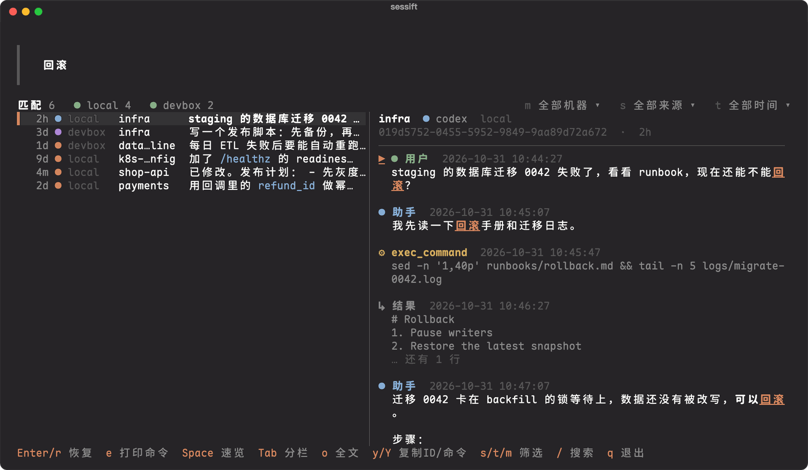
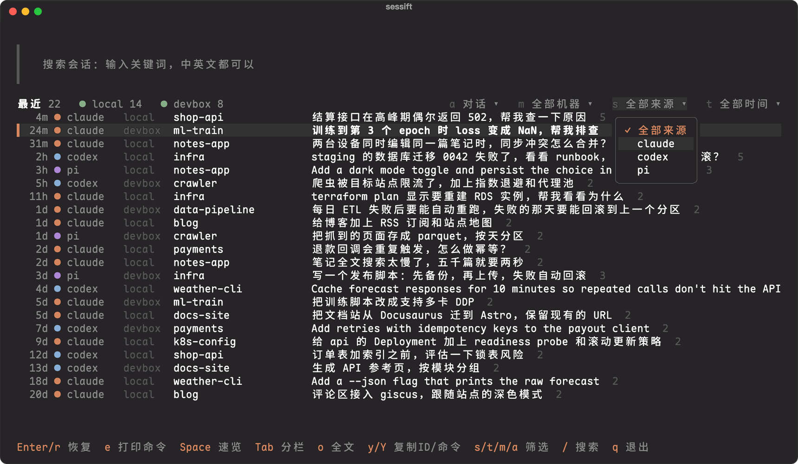
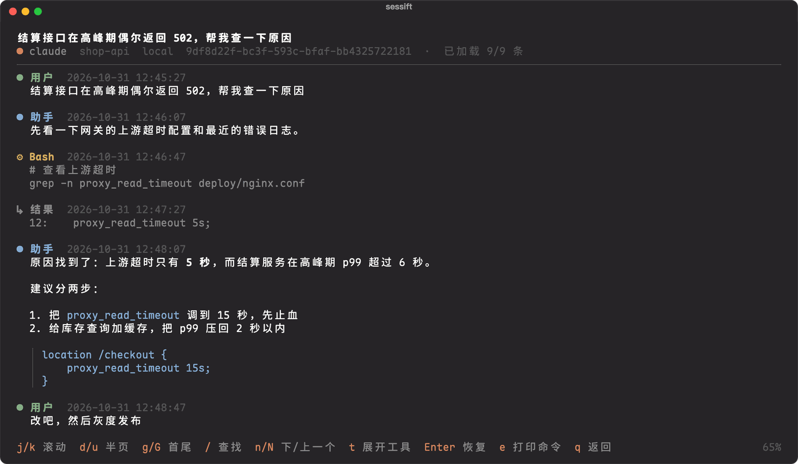

# sessift

在本机和其他机器上，一起搜索、浏览、恢复 AI 编程助手的会话：Claude Code、Codex、Pi、OpenCode、Grok。



- **快**：本机加一台远端机器一起搜，从敲下命令到出结果 29 毫秒，和一次网络往返（约 25 毫秒）差不多。
- **数据不用同步**：会话留在各自的机器上，查询时到每台机器现场查，只把结果传回来。能 `ssh` 上去就行。
- **中英文全文搜索**：边打字边搜，按会话排序，每个会话只显示最相关的一条。
- **找到就能接着干**：Enter 直接恢复会话，远端的会话自动 `ssh -t` 过去。
- **索引小而快**：47 万条记录（9.7GB 会话记录）8.8 秒建完索引，索引只有 462MB；之后查询前自动增量更新，没有新记录时只花约 19 毫秒。
- **只读**：不改动任何会话文件，索引放在 `~/.sessift`。

## 安装

### Homebrew（推荐）

macOS（Apple Silicon）：

```sh
brew install kadaliao/tap/sessift
```

装的是 Releases 里的预编译版本，不用编译。第一次要用 `kadaliao/tap/sessift` 这个全名：Homebrew 会自动加上 tap [kadaliao/homebrew-tap](https://github.com/kadaliao/homebrew-tap) 并信任这个 formula。只 `brew tap` 再用短名字 `brew install sessift`，新版 Homebrew 会以"未信任的 tap"为由拒绝，这时改用全名，或先 `brew trust kadaliao/tap`。

装好以后直接用 `sessift` 这个名字：

```sh
brew upgrade sessift      # 升级到最新版本
brew uninstall sessift    # 卸载
brew untap kadaliao/tap   # 不再需要这个 tap 时
```

卸载不会删掉索引和配置（`~/.sessift`），不要了就手动删这个目录。

### 下载预编译版本

从 [Releases](https://github.com/kadaliao/sessift/releases) 下载 `sessift-<版本>-aarch64-apple-darwin.tar.gz`，解压后把 `sessift` 放进 `PATH`：

```sh
tar xzf sessift-*-aarch64-apple-darwin.tar.gz
install -m 755 sessift ~/.local/bin/sessift
```

用浏览器下载时 macOS 可能拦截这个未签名的程序，执行 `xattr -d com.apple.quarantine sessift` 后再运行。

### 从源码安装

Intel Mac、Linux 等其他平台，用 Rust 从源码安装：

```sh
cargo install --git https://github.com/kadaliao/sessift --locked
```

### 开始使用

远端机器不需要装 Homebrew，用 `sessift remote install` 从本机装过去，见[多台机器](#多台机器)。

装好后：

```sh
sessift init     # 生成配置 ~/.sessift/config.toml
sessift          # 打开交互界面
```

第一次运行会先建索引，会话多时要几秒到十几秒。

## 交互界面

运行 `sessift`，打字就是搜索；搜索框为空时列出最近的会话。按 ↓ 或 Enter 进入列表，列表里单个字母就是命令。



| 按键 | 作用 |
|---|---|
| ↓ / Enter | 从搜索框进入列表 |
| Enter | 恢复选中的会话 |
| e | 把恢复命令放到命令行，不执行 |
| Space | 速览（n/p 切换上下条） |
| Tab | 开关右侧分栏预览 |
| o | 全文阅读 |
| s / t / m / a | 切换来源、时间、机器、会话种类；在搜索框里用 Alt-s / Alt-t / Alt-m / Alt-a |
| y / Y | 复制会话 ID / 恢复命令 |
| / 或 Esc | 回到搜索框 |
| Esc（搜索框里） | 清空搜索，再按一次退出 |

鼠标也能用：单击选中，双击恢复；单击状态行的筛选弹出下拉菜单；滚轮滚动鼠标所在的列表或预览；底部的按键提示可以直接点。

全文阅读里，Markdown 正常排版，工具调用默认折叠；j/k 滚动，`/` 查找，t 展开工具输出，Enter 恢复。从搜索结果打开时直接跳到命中的那条。



### 快捷键

在 shell 里按 Alt-M 打开，选中后恢复命令交给 shell 执行，会进入历史记录：

```sh
sessift shell fish | source     # fish：放进 fish_user_key_bindings 函数
eval "$(sessift shell zsh)"      # zsh：放进 ~/.zshrc
eval "$(sessift shell bash)"     # bash：只放到命令行，不自动执行
```

换键用 `--key`，如 `sessift shell fish --key ctrl-o`。Alt 组合键需要终端把 Option 当 Alt 发送：Ghostty 设 `macos-option-as-alt = true`，iTerm2 把 Option 键设为 Esc+。

## 多台机器

远端机器要能用 `ssh <别名>` 免密登录。和本机是同一平台时（比如都是 Apple Silicon 的 Mac），一条命令就能把本机的 sessift 装过去：

```sh
sessift remote install devbox    # 装到 devbox 的 ~/.sessift/bin/sessift
```

平台不同时，在远端从源码安装，再用下面的 `remote_command` 指向它。

然后在 `~/.sessift/config.toml` 里加上这台机器：

```toml
[defaults]
machines = ["local", "devbox"]   # 默认查哪些机器
timeout = "5s"                   # 每台机器的截止时间

[[machine]]
id = "devbox"
ssh = "devbox"                   # ~/.ssh/config 里的 Host
# remote_command = "~/.sessift/bin/sessift"   # 远端 sessift 的位置
```

- 各台机器同时查，先到先显示，慢机器不拖累其他机器；超时的机器给出提示，其余结果照常返回。
- 后台的 broker 为每台机器保持一条 SSH 连接，查询不用每次重新握手。笔记本休眠唤醒或断网后自动重连，请求半路断了会自动重发。
- 只传结果：搜索只回前几十条摘要，正文按页取，较大的响应用 zstd 压缩。慢链路上也很快。
- `sessift doctor` 检查每台机器的连接、版本和延迟。broker 的日志在 `~/.sessift/log/broker.log`，`sessift broker stop` 可以停掉它。

<details>
<summary>全部配置项</summary>

配置文件在 `~/.sessift/config.toml`，用环境变量 `SESSIFT_HOME` 可以换目录。

```toml
[defaults]
machines = ["local", "devbox"]   # 不带 -m 时查哪些机器
timeout = "5s"                   # 每台机器的截止时间

[backend]
kind = "native"
# refresh_every = "2s"           # 查询前最多多久检查一次新记录；"0" 表示不自动更新
# max_concurrency = 4            # 本机作为远端时，同时执行的请求数

[broker]
# enabled = true                 # false 表示每次直接起 SSH
# idle_timeout = "30m"           # 空闲多久后退出
# probe_after_idle = "20s"       # 连接空闲多久后，下次请求先探测连接是否还活着

[[machine]]
id = "devbox"
label = "开发机"                 # 可选，显示用
ssh = "devbox"                   # ~/.ssh/config 里的 Host
# remote_command = "~/.sessift/bin/sessift"
# ssh_options = ["-o", "Compression=no"]
```

</details>

## 命令行

```
$ sessift search 回滚 -n 3 --per-session
  4.0  2026-10-31 10:38  local   codex   infra          user  019d5752-0455-5952-9849-9aa89d72a672
       staging 的数据库迁移 0042 失败了，看看 runbook，现在还能不能回滚？
  3.5  2026-10-28 11:26  devbox  pi      infra          user  4d7af282-25b2-52e5-828f-f4ddb36cc7cc
       写一个发布脚本：先备份，再上传，失败自动回滚
  3.1  2026-10-30 12:38  devbox  claude  data-pipeline  user  930af6c6-188c-5cc8-868d-8ee59e0eb76a
       每日 ETL 失败后要能自动重跑，失败的那天要能回滚到上一个分区
```

| 命令 | 作用 |
|---|---|
| `sessift search <词…>` | 搜索。`-m` 选机器（`all` 表示全部），`-n` 条数，`--source`、`--project`、`--cwd`、`--since 7d` 等过滤，`--per-session` 每个会话一条 |
| `sessift sessions` | 按最后活跃时间列会话 |
| `sessift read <会话 ID>` | 分页读正文，自动在各台机器上找这个会话 |
| `sessift` | 交互界面 |
| `sessift shell fish\|zsh\|bash` | 输出快捷键绑定 |
| `sessift doctor` | 诊断连接、版本、延迟 |
| `sessift remote install <机器…>` | 安装或更新远端的 sessift |
| `sessift index` | 手动建立或更新本机索引（平时查询前会自动更新） |

终端里默认输出文本，管道里默认输出 JSON Lines，方便接 `jq` 或别的脚本；`--format json` 输出一个完整文档，附带每台机器的耗时和错误。每个命令的完整参数见 `sessift <命令> --help`。

## 支持的来源

| 来源 | 读取位置 |
|---|---|
| Claude Code | `~/.claude/projects` |
| Codex | `~/.codex/sessions`，包括压缩过的旧会话（`.jsonl.zst`） |
| Pi | `~/.pi/agent/sessions` |
| OpenCode | `~/.local/share/opencode` 里的数据库 |
| Grok | `~/.grok/sessions` |

会话列表默认只列人参与的对话；子 agent、`codex exec` 这类脚本跑的会话按 `a` 或 `--kind all` 才显示，搜索时排在后面。

## 性能

MacBook 加一台 Mac mini，链路往返约 25ms。从命令启动到结束，20 次取中位数：

| 场景 | 耗时 |
|---|---|
| 搜索，本机 + 远端 | 29ms |
| 搜索，只查远端 | 45ms |
| 搜索，只查本机 | 21ms |
| 列 50 个会话，本机 + 远端 | 30ms |
| 搜索，只查远端，不经 broker（每次新建 SSH 连接） | 168ms |

本机索引（9.7GB 会话记录、47 万条）：

| 场景 | 耗时 |
|---|---|
| 查询前检查新记录，没有变化 | 约 19ms |
| 查询前增量更新，有新记录（正在进行的会话） | 25～35ms |
| 从零建索引 | 8.8 秒，索引 462MB |

## 开发

```sh
cargo fmt --check && cargo clippy --all-targets && cargo test
```

设计和路线图见 [docs/plan.md](docs/plan.md)，远程协议见 [docs/remote-protocol.md](docs/remote-protocol.md)，各来源的格式见 [docs/formats.md](docs/formats.md)。
