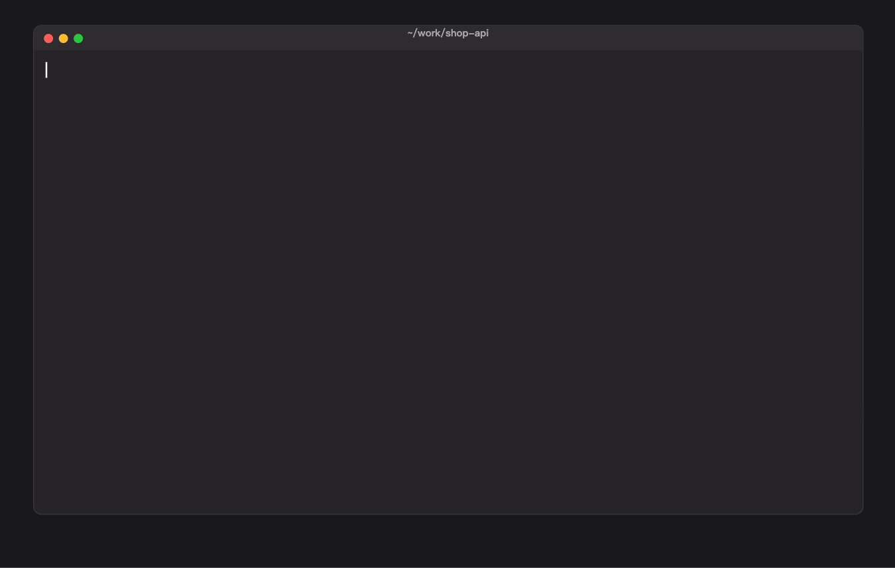
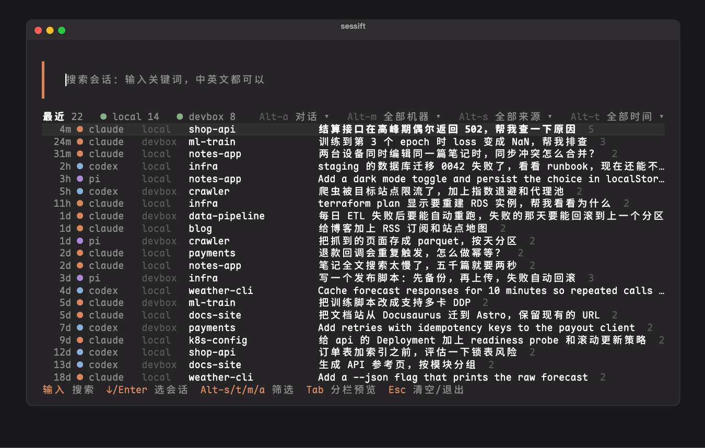
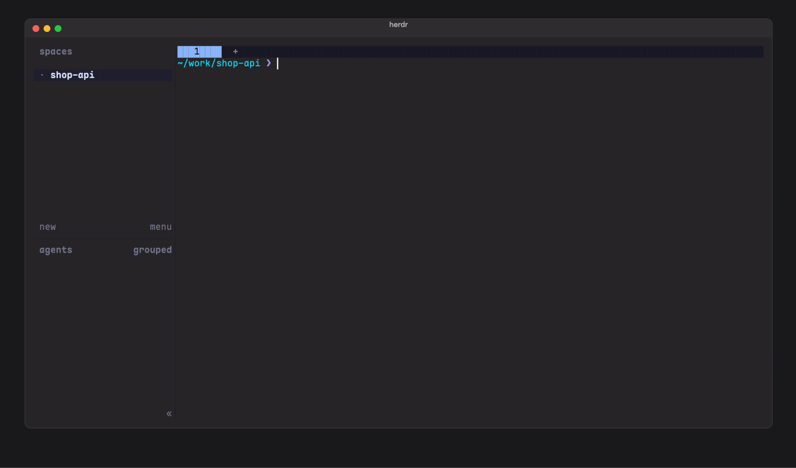

# sessift

在本机和其他机器上，一起搜索、浏览、恢复 AI 编程助手的会话：Claude Code、Codex、Pi、OpenCode、Grok。



- **快**：本机加一台远端机器一起搜，从敲下命令到出结果约 30 毫秒。
- **数据不用同步**：会话留在各自的机器上，查询时到每台机器现场查，只把结果传回来。能 `ssh` 上去就行。
- **找到就能接着干**：Enter 直接恢复会话，远端的会话自动 `ssh -t` 过去。
- **哪里都能打开**：shell 里按 Alt-M，herdr 里按 prefix+m；agent 也能自己查（自带 skill）。
- **只读**：不改动任何会话文件，索引放在 `~/.sessift`。

## 安装

```sh
brew install kadaliao/tap/sessift   # macOS（Apple Silicon）
sessift init                        # 生成配置 ~/.sessift/config.toml
sessift                             # 打开交互界面
```

第一次要用全名 `kadaliao/tap/sessift`，Homebrew 会自动加上并信任这个 tap。其他平台用 `cargo install --git https://github.com/kadaliao/sessift --locked`，或者从 [Releases](https://github.com/kadaliao/sessift/releases) 下载。第一次运行会先建索引，会话多时要几秒到十几秒。

## 交互界面

打字就是搜索，搜索框为空时列出最近的会话。Tab 或 ↓ 进入列表，列表里单个字母就是命令：

| 按键 | 作用 |
|---|---|
| Enter / e | 恢复会话 / 只把恢复命令放到命令行 |
| Tab / Space | 分栏预览 / 速览 |
| o | 全文阅读：Markdown 排版，`/` 查找，t 展开工具输出 |
| s / t / m / a | 筛选来源、时间、机器、会话种类（搜索框里加 Alt） |
| y / Y | 复制会话 ID / 恢复命令 |
| Esc | 回到搜索框；再按清空、退出 |

鼠标也能用：单击选中，双击恢复，单击筛选弹出菜单，滚轮滚动。



### shell 快捷键

```sh
sessift shell fish | source     # fish：放进 fish_user_key_bindings 函数
eval "$(sessift shell zsh)"      # zsh：放进 ~/.zshrc
eval "$(sessift shell bash)"     # bash：只放到命令行，不自动执行
```

按 Alt-M 打开，恢复命令交给 shell 执行，会进入历史记录。换键用 `--key ctrl-o`。Alt 组合键要终端把 Option 当 Alt 发送（Ghostty 设 `macos-option-as-alt = true`，iTerm2 设 Esc+）。只对之后启动的 shell 生效，已经开着的终端执行一次 `exec fish`。

### herdr



在 [herdr](https://herdr.dev) 里，任何 pane 上都能用浮层打开，包括正在跑 agent 的 pane（agent 自己会收走 Alt-M）：

```sh
herdr plugin install kadaliao/sessift/herdr
```

```toml
# ~/.config/herdr/config.toml
[[keys.command]]
key = "prefix+m"
type = "plugin_action"
command = "sessift.open"
description = "搜索并恢复 agent 会话"
```

按 Enter 时：会话已经在某个 pane 里开着，就跳过去；浮层下面是空闲的 shell，就在那里恢复；否则在当前 workspace 新开一个 tab。

## 多台机器

远端要能 `ssh <别名>` 免密登录。同一平台时一条命令把本机的 sessift 装过去，再在配置里加上这台机器：

```sh
sessift remote install devbox    # 装到 devbox 的 ~/.sessift/bin/sessift
```

```toml
# ~/.sessift/config.toml
[defaults]
machines = ["local", "devbox"]   # 默认查哪些机器
timeout = "5s"                   # 每台机器的截止时间

[[machine]]
id = "devbox"
label = "开发机"                 # 可选，显示用
ssh = "devbox"                   # ~/.ssh/config 里的 Host
# remote_command = "~/.sessift/bin/sessift"   # 平台不同时，指向远端自己编译的 sessift
```

各台机器同时查，先到先显示，超时的机器给出提示、不拖累其他机器。后台的 broker 为每台机器保持一条 SSH 连接，断网、休眠后自动重连。`sessift doctor` 检查连接、版本和延迟。

<details>
<summary>其余配置项</summary>

用环境变量 `SESSIFT_HOME` 可以换掉 `~/.sessift`。

```toml
[backend]
kind = "native"
# refresh_every = "2s"           # 查询前最多多久检查一次新记录；"0" 表示不自动更新
# max_concurrency = 4            # 本机作为远端时，同时执行的请求数

[broker]
# enabled = true                 # false 表示每次直接起 SSH
# idle_timeout = "30m"           # 空闲多久后退出
# probe_after_idle = "20s"       # 连接空闲多久后，下次请求先探测连接是否还活着

[[machine]]
# ssh_options = ["-o", "Compression=no"]
```

</details>

## 给 agent 用

```sh
sessift skill install
```

装上自带的 [skill](skills/sessift/SKILL.md) 以后，你说"上次在另一台机器上是怎么配 nginx 的""接着做昨天那个迁移脚本"，Claude Code、Codex 等会自己用 sessift 去找、去读。它写到 `~/.agents/skills/sessift/`，并链接到 `~/.claude/skills/`；升级 sessift 后再执行一次。agent 里运行时会自动排除 agent 自己正在进行的会话。

## 命令行

| 命令 | 作用 |
|---|---|
| `sessift search <词…>` | 搜索。`-m` 选机器（`all` 为全部），`--since 7d`、`--project`、`--source` 等过滤，`--per-session` 每个会话一条 |
| `sessift sessions` | 按最后活跃时间列会话 |
| `sessift read <会话 ID>` | 分页读正文；`--around <record_id>` 从搜索命中处读，`--tail 30` 读最后 30 条 |
| `sessift doctor` | 诊断连接、版本、延迟 |
| `sessift remote install <机器…>` | 安装或更新远端的 sessift |

终端里输出文本，管道里输出 JSON Lines，`--format json` 输出带每台机器耗时的完整文档。完整参数见 `sessift <命令> --help`。

## 支持的来源

Claude Code（`~/.claude/projects`）、Codex（`~/.codex/sessions`，包括压缩过的 `.jsonl.zst`）、Pi（`~/.pi/agent/sessions`）、OpenCode（`~/.local/share/opencode`）、Grok（`~/.grok/sessions`）。会话列表默认只列人参与的对话，子 agent 和脚本跑的会话按 `a` 或 `--kind all` 显示。

## 性能

MacBook 加一台 Mac mini，链路往返约 25ms，20 次取中位数：

| 场景 | 耗时 |
|---|---|
| 搜索，本机 + 远端 | 30ms |
| 搜索，只查本机 | 24ms |
| 查询前检查新记录，没有变化 | 约 19ms |
| 从零建索引（9.7GB、47 万条记录） | 8.8 秒，索引 462MB |

## 开发

```sh
cargo fmt --check && cargo clippy --all-targets && cargo test
scripts/screenshots/run.sh      # 重新生成 README 里的 GIF（虚构数据）
```

设计和路线图见 [docs/plan.md](docs/plan.md)，远程协议见 [docs/remote-protocol.md](docs/remote-protocol.md)，各来源的格式见 [docs/formats.md](docs/formats.md)。
